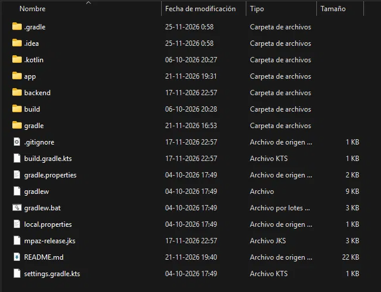
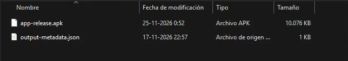
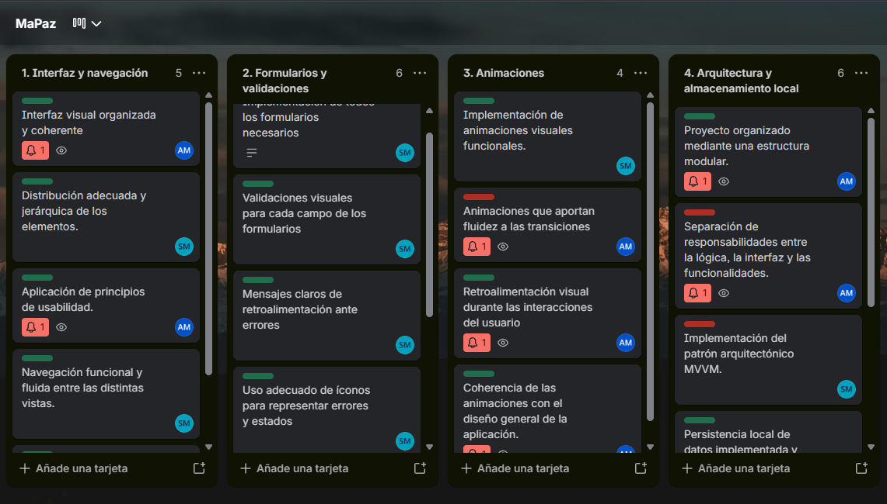
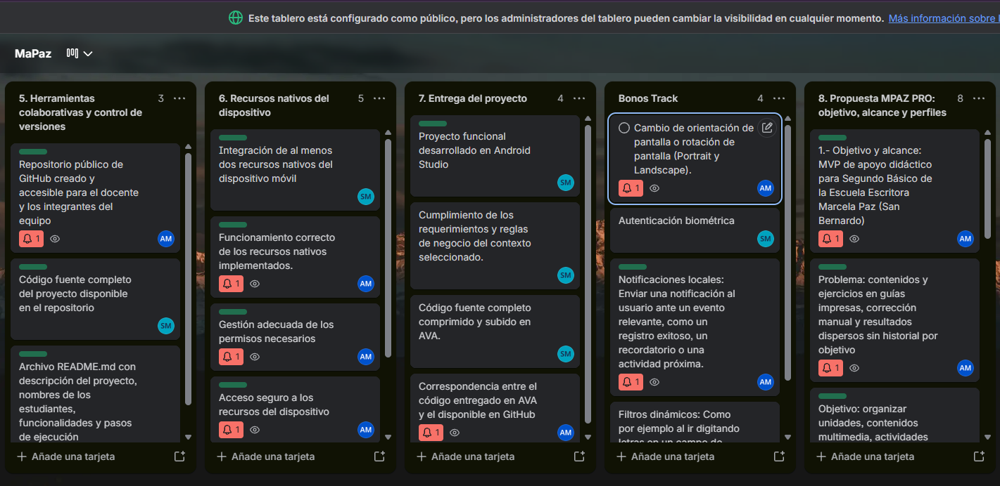
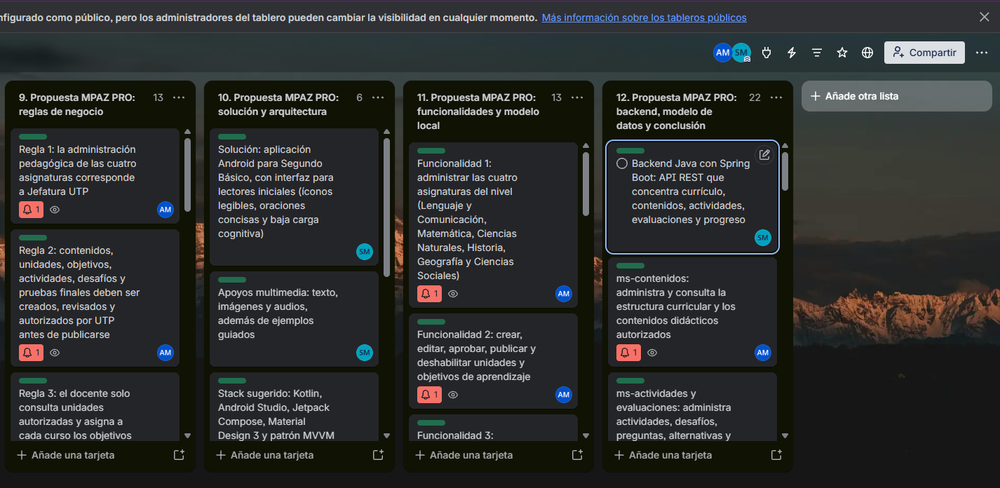

# MPAZ PRO 2.º

Aplicación móvil Android de apoyo didáctico para estudiantes de Segundo Básico
de la Escuela Escritora Marcela Paz (San Bernardo).

Proyecto de la Evaluación Parcial 4 de la asignatura DSY1105 Desarrollo de
Aplicaciones Móviles, Duoc UC.

## Integrantes

| Integrante |
|---|
| Alejandro Maturana |
| Sofía Mellado |

## Descripción del proyecto

Hoy el colegio trabaja los contenidos de Segundo Básico con guías impresas que
cada docente redacta, imprime, reparte y corrige a mano. Los resultados quedan
en papel y no existe un registro del avance de cada estudiante por objetivo de
aprendizaje.

MPAZ PRO 2.º reemplaza ese proceso por una aplicación que organiza unidades
didácticas de las cuatro asignaturas del nivel, con explicaciones breves y
lectura en voz alta. La app permite publicar contenidos, asignarlos a un curso,
rendir pruebas y revisar los resultados.

La aplicación Android se conecta a un **backend de microservicios** (Spring Boot
y MySQL) a través de un API Gateway, y consume además una **API externa**
(Wikipedia) para mostrar un dato curioso al estudiante.

Corresponde a un Producto Mínimo Viable (MVP). Es una herramienta de apoyo y no
reemplaza la labor ni la evaluación del docente.

### Asignaturas incluidas

- Lenguaje y Comunicación
- Matemática
- Ciencias Naturales
- Historia, Geografía y Ciencias Sociales

## Perfiles de usuario

### Jefatura UTP

- Crea y edita unidades con su código OA, objetivo de aprendizaje, explicación
  y ejemplo.
- Crea y elimina las preguntas de cada unidad (cuatro alternativas, una correcta).
- Controla el estado de cada unidad: Borrador, En revisión, Autorizado,
  Publicado y Deshabilitado.
- Filtra las unidades por asignatura.

### Docente

- Consulta solo las unidades que la UTP ya publicó.
- Asigna unidades a un curso y define el rango de fechas de disponibilidad.
- Configura el número máximo de intentos (de 1 a 3), que se aplica a la prueba
  de esa unidad.
- Decide si el estudiante puede revisar sus respuestas al terminar la prueba.
- Decide si se avisa o no al curso. Cuando se avisa, se envía una notificación.
- Revisa el informe de intentos, notas y promedio, visible solo para este perfil.
- Registra observaciones pedagógicas por estudiante.

### Estudiante

- Ingresa a su perfil de prueba.
- Ve solo las unidades que el docente le asignó, dentro de cada asignatura. Una
  unidad publicada por la UTP que todavía no fue asignada no aparece.
- Lee las explicaciones de cada asignatura y las escucha en voz alta.
- Rinde la prueba de cada unidad asignada, formada por las preguntas que creó la
  UTP, dentro de los intentos permitidos. Las pruebas aparecen agrupadas por
  asignatura.
- Recibe su nota en escala de 1,0 a 7,0. La opción de revisar las respuestas
  aparece solo si el docente la habilitó al asignar la unidad.
- Realiza una actividad con la cámara en Ciencias Naturales (animales).
- Ve su avance: mejor nota, promedio e intentos usados en cada prueba.
- Ve la tarjeta "Conectando aprendo" con un resumen de Wikipedia por asignatura.
- No tiene acceso a informes pedagógicos.

### Cuentas de prueba

Se inicia sesión con **correo y contraseña**. El perfil (Alumno, Docente o UTP)
no se elige: lo decide la cuenta, y lo entrega el backend dentro del token JWT.
Son datos ficticios, solo para probar la aplicación.

| Perfil | Correo | Contraseña |
|---|---|---|
| UTP | `utp@mpaz.cl` | `123456` |
| Docente | `docente@mpaz.cl` | `123456` |
| Estudiante | `estudiante@mpaz.cl` | `123456` |

Estas cuentas las crea el `auth-service` la primera vez que arranca (si no
existen). Para que el login funcione, el backend debe estar corriendo (ver
[Backend](#backend-microservicios)).

## Funcionalidades implementadas

- **Inicio de sesión contra el backend** (`POST /auth/login`) con redirección
  según el perfil de la cuenta y cierre de sesión. La sesión se mantiene al
  girar el teléfono.
- **Contraseñas cifradas** en el backend (hash en `auth-service`); la app nunca
  las guarda.
- **Navegación** entre pantallas: barra inferior, menú lateral y botón para volver.
- **Formularios con validación por campo**, ícono, indicador de campo correcto y
  mensaje de error visible: unidad, pregunta, asignación y observación. Los
  campos de fecha se formatean solos (`dd/mm/aaaa`).
- **Validaciones centralizadas** en un solo objeto (`Validador`) y en `Fechas`,
  separadas de los componentes visuales.
- **Gestión de unidades y preguntas** con control de estados de publicación,
  guardadas en los microservicios `contenidos-service` y `actividades-service`.
- **Asignación de unidades** con fechas, máximo de intentos y permiso para
  revisar respuestas, guardadas en `progreso-service`.
- **Pruebas por unidad** generadas con las preguntas de la UTP, con intentos
  limitados, nota en escala chilena y revisión de respuestas.
- **Informe pedagógico** reservado al perfil docente.
- **API externa (Wikipedia)**: tarjeta "Conectando aprendo" en el perfil del
  estudiante.
- **Persistencia local con Room** como copia de los datos del servidor.
- **Animaciones**: transición entre el inicio de sesión y cada panel, entre las
  pestañas de los tres perfiles y entre la lista, el detalle y la edición de
  unidades de la UTP. También hay animaciones en los mensajes de error, en los
  íconos de los formularios y en la barra de progreso de la actividad con cámara.
- **Recursos nativos** del dispositivo (ver más abajo).
- **Pruebas unitarias** de la lógica (176 pruebas, 96 % de cobertura).

### Reglas que la aplicación hace cumplir

| Regla | Dónde se aplica |
|---|---|
| Una unidad sin preguntas no puede pasar a revisión | UTP |
| Los estados siguen el orden Borrador → En revisión → Autorizado → Publicado → Deshabilitado; no se pueden saltar pasos | UTP |
| Una unidad publicada no se puede editar ni cambiar sus preguntas | UTP |
| El código OA debe tener el formato `OA-XXX-00` y no puede repetirse | UTP |
| Solo se pueden asignar unidades publicadas | Docente |
| Solo se puede asignar una unidad que tenga prueba con preguntas | Docente |
| No se puede asignar la misma unidad dos veces al mismo curso | Docente |
| La fecha de término no puede ser anterior a la de inicio ni a la de hoy | Docente |
| El máximo de intentos va de 1 a 3 | Docente |
| El estudiante solo ve las unidades que fueron asignadas | Estudiante |
| Cuando el estudiante agota sus intentos, no puede volver a rendir la prueba | Estudiante |
| Solo se puede comentar una unidad que ya fue asignada | Docente |
| Los informes solo se ven en el perfil docente y muestran códigos de estudiante, nunca nombres ni RUT | Docente |

### Límites de los campos de texto

| Campo | Largo permitido |
|---|---|
| Título de la unidad | 5 a 60 caracteres |
| Objetivo de aprendizaje | 10 a 150 caracteres |
| Explicación | 20 a 300 caracteres |
| Ejemplo | 5 a 200 caracteres |
| Pregunta | 10 a 150 caracteres |
| Alternativa | 1 a 60 caracteres |

## Recursos nativos

| Recurso | Uso en la aplicación |
|---|---|
| Notificaciones | Avisa cuando el docente asigna una unidad a un curso. |
| Texto a voz | Lee en voz alta las explicaciones y los ejemplos al estudiante, tanto de las asignaturas como de las unidades publicadas por la UTP. |
| Cámara | En la actividad de animales de Ciencias Naturales, el estudiante toma fotografías con la app de cámara del teléfono. |

Las notificaciones solicitan permiso en Android 13 o superior. Si el permiso se
niega, la aplicación sigue funcionando sin ese aviso. La cámara se abre con la
aplicación de cámara instalada en el teléfono y entrega la foto mediante un
`FileProvider`, por eso no requiere el permiso `CAMERA`.

## Backend (microservicios)

La carpeta `backend/` contiene los microservicios Spring Boot que usa la app.
Todo el tráfico pasa por el **API Gateway** (`http://localhost:9090`), que
redirige cada ruta al servicio que corresponde. Cada servicio tiene su propia
base de datos MySQL y sus tablas se crean con **Liquibase**.

| Servicio | Puerto | Base de datos | Rutas en el gateway |
|---|---|---|---|
| `api-gateway` | 9090 | — | Punto de entrada de la app |
| `auth-service` | 9094 | `bd_users` | `/auth/**` |
| `contenidos-service` | 9096 | `bd_contenidos` | `/asignaturas/**`, `/unidades/**`, `/objetivos/**`, `/contenidos/**` |
| `actividades-service` | 9097 | `bd_actividades` | `/desafios/**`, `/pruebas/**`, `/preguntas/**` |
| `progreso-service` | 9098 | `bd_progreso` | `/asignaciones/**`, `/progreso/**`, `/informes/**`, `/observaciones/**`, `/intentos/**` |
| `admin-service` | 9099 | `bd_admin` | `/admin/**` |

La seguridad usa **JWT**: el login entrega un token con el rol del usuario y la
app lo envía en cada petición con el encabezado `Authorization: Bearer <token>`.

### Endpoints de los microservicios

Todas las rutas se llaman a través del gateway (`http://localhost:9090`).

**auth-service**

| Método | Ruta | Descripción |
|---|---|---|
| POST | `/auth/login` | Valida correo y contraseña y devuelve el token JWT |
| POST | `/auth/register` | Registra un usuario nuevo |

**contenidos-service**

| Método | Ruta | Descripción |
|---|---|---|
| GET, POST | `/asignaturas` | Lista y crea asignaturas |
| GET, PUT, DELETE | `/asignaturas/{id}` | Consulta, edita o elimina una asignatura |
| GET, POST | `/unidades` | Lista y crea unidades |
| GET, PUT, DELETE | `/unidades/{id}` | Consulta, edita o elimina una unidad |
| PATCH | `/unidades/{id}/estado` | Cambia el estado de la unidad (flujo de publicación) |
| GET, POST | `/objetivos` | Lista y crea objetivos de aprendizaje |
| GET, PUT, DELETE | `/objetivos/{id}` | Consulta, edita o elimina un objetivo |
| PATCH | `/objetivos/{id}/estado` | Cambia el estado del objetivo |
| GET | `/objetivos/{id}/exists` | Comprueba que el objetivo existe |
| GET, POST | `/contenidos` | Lista y crea contenidos didácticos |
| GET, PUT, DELETE | `/contenidos/{id}` | Consulta, edita o elimina un contenido |

**actividades-service**

| Método | Ruta | Descripción |
|---|---|---|
| GET, POST | `/pruebas` | Lista y crea pruebas finales (se filtran por `objetivoId`) |
| GET, PUT, DELETE | `/pruebas/{id}` | Consulta, edita o elimina una prueba |
| GET, POST | `/preguntas` | Lista y crea preguntas con sus alternativas |
| GET, PUT, DELETE | `/preguntas/{id}` | Consulta, edita o elimina una pregunta |
| GET, POST | `/desafios` | Lista y crea desafíos |
| GET, PUT, DELETE | `/desafios/{id}` | Consulta, edita o elimina un desafío |

**progreso-service**

| Método | Ruta | Descripción |
|---|---|---|
| GET, POST | `/asignaciones` | Lista y crea asignaciones de una unidad a un curso |
| GET, PUT, DELETE | `/asignaciones/{id}` | Consulta, edita o elimina una asignación |
| POST | `/asignaciones/{id}/intentos` | Registra un intento de prueba del estudiante |
| GET | `/intentos/{id}` | Revisión de un intento |
| GET | `/progreso/estudiantes/{codigo}/avance` | Avance del estudiante (intentos, mejor nota, promedio) |
| GET | `/informes/asignaciones/{id}` | Informe de una asignación para el docente |
| GET, POST | `/observaciones` | Lista y crea observaciones del docente |

**admin-service**

| Método | Ruta | Descripción |
|---|---|---|
| POST | `/admin/aprobaciones` | Registra una aprobación de la UTP |
| GET | `/admin/historial` | Historial de aprobaciones |

### Ejecutar el backend

Requisitos: **Docker Desktop** y **JDK 17 o superior**.

1. Generar el `.jar` de cada servicio. Desde la carpeta `backend`, en
   PowerShell, repetir para `api-gateway`, `auth-service`, `contenidos-service`,
   `actividades-service`, `progreso-service` y `admin-service`:

```powershell
cd backend\auth-service
.\mvnw clean package -DskipTests -s ..\configuracion-maven\settings.xml
cd ..
```

2. Levantar todo con Docker Compose (MySQL incluido, puerto 3307 en el PC):

```powershell
cd backend
docker compose up -d --build
```

3. Comprobar que los contenedores estén arriba con `docker compose ps`. El
   gateway queda en `http://localhost:9090`.

Para detener los servicios: `docker compose stop`. Para borrar también los
datos de MySQL: `docker compose down -v`.

La app Android usa la dirección `http://10.0.2.2:9090/`, que es como el
**emulador** de Android ve el `localhost` del computador. Está definida en
`RedMpaz.kt` (constante `URL_BASE`).

## API externa

La tarjeta **"Conectando aprendo"** del perfil del estudiante consume la API REST
pública de **Wikipedia en español**. No usa el backend propio ni el token de la
sesión.

| Dato | Valor |
|---|---|
| URL base | `https://es.wikipedia.org/` |
| Endpoint | `GET api/rest_v1/page/summary/{titulo}` |
| Uso | Trae el título, un resumen corto y la foto de un tema |

La tarjeta tiene un botón por asignatura. Cada botón tiene una lista de temas
pensados para básica (por ejemplo "Cuento", "Suma", "Abeja") y cada día se
muestra uno distinto. Si no hay internet, la tarjeta muestra un mensaje de error
y el resto de la app sigue funcionando. La llamada está en `RedWikipedia.kt`, la
lógica en `RepositorioWikipedia` y `ConocimientoViewModel`, y la tarjeta en
`MiradaAlMundo.kt`.

## Persistencia de datos

La fuente de los datos es el backend (MySQL). Además, la app guarda una copia en
una base de datos **Room** (SQLite), `BaseDatosMpaz`, versión 3, para no
perder lo cargado:

| Tabla | Contenido |
|---|---|
| `usuarios` | Cuentas de acceso |
| `unidades` | Unidades didácticas y su estado |
| `preguntas` | Preguntas de cada unidad |
| `asignaciones` | Unidad asignada a un curso, con fechas, máximo de intentos y permiso para revisar respuestas |
| `observaciones` | Comentarios del docente sobre un estudiante |

Los intentos usados y las notas de las pruebas del estudiante se guardan en
`SharedPreferences`, un archivo por unidad, además de enviarse al backend.

## Tecnologías

- Kotlin
- Android Studio
- Jetpack Compose (toda la interfaz se escribe en Kotlin, sin XML de pantallas)
- Material Design 3
- Animaciones de Compose (`AnimatedContent`)
- Arquitectura MVVM
- Retrofit y Gson para consumir el backend y la API externa
- Corrutinas de Kotlin
- Room (SQLite) con KSP para la persistencia local
- SharedPreferences para los resultados de las pruebas
- Backend: Java, Spring Boot, Spring Cloud Gateway, JWT, Liquibase, MySQL y Docker
- JUnit 4, MockK y JaCoCo para las pruebas unitarias
- Git y GitHub para el control de versiones

## Arquitectura

```text
app/src/main/java/com/example/mpaz_pro_app_movil/
├── MainActivity.kt     Punto de entrada y acceso según el perfil
├── auth/               Perfiles (RolUsuario) e inicio de sesión contra el backend
├── components/         Componentes reutilizables (campo validado, etiqueta de estado, transiciones)
├── datos/              Base de datos Room y datos de prueba
│   ├── dao/            Consultas a cada tabla
│   ├── entidad/        Tablas de Room
│   ├── model/          Modelos que usa la interfaz
│   └── repositorio/    Almacén compartido de listas y repositorio local
├── notificaciones/     Aviso al asignar una unidad
├── pruebas/            Prueba de cada unidad (se arma con las preguntas de la UTP) y su pantalla compartida
├── red/                Retrofit, sesión con el token y repositorios del backend y de Wikipedia
├── screens/            Pantallas de los tres perfiles
├── ui/theme/           Colores y tipografía
├── validacion/         Validador central y manejo de fechas
└── viewmodel/          Estado y reglas de los tres perfiles
```

Flujo de los datos:

```text
Pantalla  →  ViewModel  →  Repositorio (red)  →  Retrofit  →  API Gateway  →  Microservicio  →  MySQL
 (muestra)   (reglas)      (traduce datos)                    (puerto 9090)

                   └──→  AlmacenMpaz (listas que se redibujan)  →  Room (copia local)
```

- **screens y components:** muestran el estado y envían los eventos del usuario.
- **viewmodel:** contiene las reglas (bloqueos, estados, qué unidades ve el
  estudiante) y devuelve el motivo cuando una acción no se puede realizar.
- **red:** los repositorios hablan con el backend y traducen los errores del
  servidor (400, 403, 404, 409...) a mensajes que entiende la persona.
- **datos:** `AlmacenMpaz` mantiene las listas compartidas, de modo que lo que
  publica la UTP aparece en el perfil docente y lo que asigna el docente aparece
  en el estudiante sin reiniciar la aplicación.
- **validacion:** reúne todas las validaciones en un solo lugar.

## Pruebas unitarias

La lógica de la aplicación se prueba con **JUnit 4** y **MockK** (para simular
el servidor), con corrutinas de prueba. Hay **176 pruebas** en
`app/src/test/`, que cubren:

- los ViewModels de UTP, Docente, Estudiante y Conocimiento;
- los repositorios de `red` (contenidos, pruebas, asignaciones, evaluaciones,
  observaciones, informes y Wikipedia);
- el validador de formularios, el manejo de fechas, el cálculo de la nota y los
  estados de las unidades;
- el inicio de sesión y el cifrado de claves.

Ejecutar las pruebas desde la carpeta del proyecto:

```powershell
.\gradlew.bat testDebugUnitTest
```

### Cobertura (JaCoCo)

El reporte mide solo la lógica (ViewModels, repositorios, validaciones,
autenticación y modelos). Las pantallas y componentes visuales (Compose) no se
incluyen porque no son lógica de negocio.

```powershell
.\gradlew.bat jacocoReporteLogica
```

El reporte queda en `app/build/reports/jacoco/jacocoReporteLogica/html/index.html`.

| Paquete | Instrucciones cubiertas |
|---|---|
| `viewmodel` | 95 % |
| `red` (repositorios) | 97 % |
| `datos.model` | 94 % |
| `auth` | 96 % |
| `validacion` | 100 % |
| `datos` (calificación) | 100 % |
| **Total** | **96 %** (83 % de las ramas) |

## Pasos para ejecutar

### Requisitos

- Android Studio instalado.
- Emulador o dispositivo con Android 7.0 (API 24) o superior.
- El backend corriendo (ver [Ejecutar el backend](#ejecutar-el-backend)).

### Instalación

1. Clonar el repositorio:

```bash
git clone https://github.com/amaturanaa/Mpaz-pro-app_movil.git
```

2. Levantar el backend (ver sección anterior).
3. Abrir Android Studio y seleccionar **File > Open**.
4. Elegir la carpeta `Mpaz-pro-app_movil` y presionar **OK**.
5. Esperar a que termine **Gradle Sync**.
6. Seleccionar un emulador y presionar **Run** para ejecutar el módulo `app`.
7. Iniciar sesión con una de las cuentas de prueba.
8. En Android 13 o superior, aceptar el permiso de notificaciones.

### APK firmada

La APK de entrega está firmada con el archivo `mpaz-release.jks`, que está en la
raíz del repositorio. La firma está configurada en `app/build.gradle.kts`
(bloque `signingConfigs`).

| Dato de la firma | Valor |
|---|---|
| Archivo | `mpaz-release.jks` (raíz del repositorio) |
| Alias | `mpaz` |
| Contraseña del keystore y de la llave | `mpaz2026` |

**Captura del `.jks` en la raíz del repositorio:**



**Captura de la APK firmada en `app/release`:**



La APK firmada está en `app/release/app-release.apk`. Para generarla de nuevo:

```powershell
.\gradlew.bat assembleRelease
```

El resultado queda en `app\build\outputs\apk\release\app-release.apk`.

> La APK se conecta a `http://10.0.2.2:9090/`, la dirección del emulador.
> Para usarla en un teléfono físico hay que cambiar `URL_BASE` en `RedMpaz.kt`
> por la IP del computador donde corre el backend, y volver a generar la APK.

### Recorrido sugerido para probar

1. Entrar como **UTP** (`utp@mpaz.cl`), crear una unidad con una pregunta y
   pasarla hasta **Publicado**. También se puede filtrar por asignatura.
2. Entrar como **Docente** (`docente@mpaz.cl`), asignar la unidad a un curso y
   revisar la notificación.
3. Entrar como **Estudiante** (`estudiante@mpaz.cl`): la unidad asignada aparece
   dentro de su asignatura, con su explicación y el botón para escucharla. Su
   prueba aparece en la pestaña **Pruebas**. Rendirla y revisar la nota en
   **Avance**. Probar también la tarjeta "Conectando aprendo".
4. Volver como **Docente** y revisar el informe y las observaciones.

## Limitaciones conocidas

Es un MVP y estas partes quedan para una siguiente versión:

- Si el docente asigna la misma unidad a varios cursos, el máximo de intentos y
  el permiso para revisar respuestas quedan con los valores de la última
  asignación.
- Las cuentas de prueba se crean al iniciar el `auth-service` y aún no existe una
  pantalla para restablecer contraseñas.
- Las notificaciones son locales: el aviso aparece en el dispositivo donde el
  docente asigna la unidad. Enviarlo al teléfono de cada estudiante requeriría un
  servidor con notificaciones push.
- La app necesita el backend en marcha para iniciar sesión y cargar los datos; la
  tarjeta de Wikipedia necesita internet.
- No hay conexión con sistemas del colegio.

## Datos y privacidad

Todos los usuarios, cursos, respuestas e informes de la aplicación son
ficticios. No se utilizan nombres, RUT ni credenciales reales de estudiantes o
de la institución. La aplicación no se conecta con sistemas del colegio ni
genera diagnósticos automáticos con inteligencia artificial.

## Control de versiones y planificación

- Repositorio: https://github.com/amaturanaa/Mpaz-pro-app_movil
- Tablero Trello: https://trello.com/b/lSow9Qaa/mapaz

La planificación del proyecto se llevó en Trello, con las tareas repartidas
entre los integrantes (AM: Alejandro Maturana, SM: Sofía Mellado). El código
se versionó en GitHub, con commits de ambos integrantes en la aplicación móvil
y en los microservicios.





